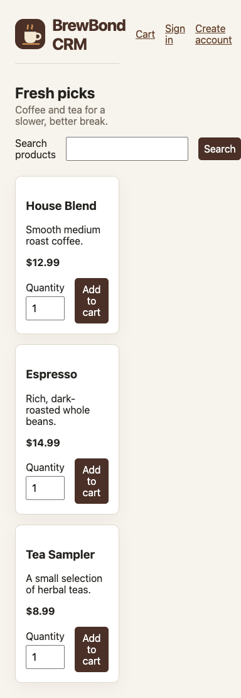

# BrewBond CRM

A small Java 12 Servlet/JSP customer relationship management app for a fictional coffee shop. It includes a searchable catalog, account registration and sign-in, a session cart, simulated checkout, and a role-protected product admin page.

## What the app does

- The catalog at `/` lists seeded coffee and tea products and supports a bounded text search.
- `/register` creates a regular customer account. `/login` signs in; `/logout` signs out.
- `/cart` shows the current browser session's cart. Users can add or remove products and run a simulated checkout.
- `/admin` is for the configured administrator. It can add products and view the catalog.
- Checkout only clears the cart. There are no payments, real orders, email, or third-party service calls.

The application uses Java Servlets and JSP views, an embedded Jetty server, and a local SQLite database. Product records are shared through SQLite; cart contents are stored in the browser's server-side session.

## Demo

1. Browse the catalog and search for a product.
2. Add a product to the cart, then remove it or run the checkout simulation.
3. Optionally register a regular account and sign in.
4. Configure the admin environment variables to use `/admin` and add a catalog product.



## Requirements

- Java 12
- Maven 3.8+

## Run

```sh
mvn package
mvn exec:java
```

Open [http://localhost:8080](http://localhost:8080). The SQLite database is created at `data/brew-bond-crm.db`; override the path with `SHOP_DB_PATH`.

To configure an admin account on first startup, provide both `SHOP_ADMIN_USERNAME` and `SHOP_ADMIN_PASSWORD`. The first configured admin is created only if the database does not already contain an admin. Usernames must be 3-32 letters, numbers, dots, dashes, or underscores; passwords must be 12-128 characters. Registration only creates ordinary users.

Example for macOS/Linux (replace the sample values with local-only values):

```sh
SHOP_ADMIN_USERNAME=demo_admin SHOP_ADMIN_PASSWORD='local-only-password-123' mvn exec:java
```

Run `mvn package` first after a clean checkout; it compiles for Java 12, runs the unit tests, and creates the WAR that the embedded server loads.
